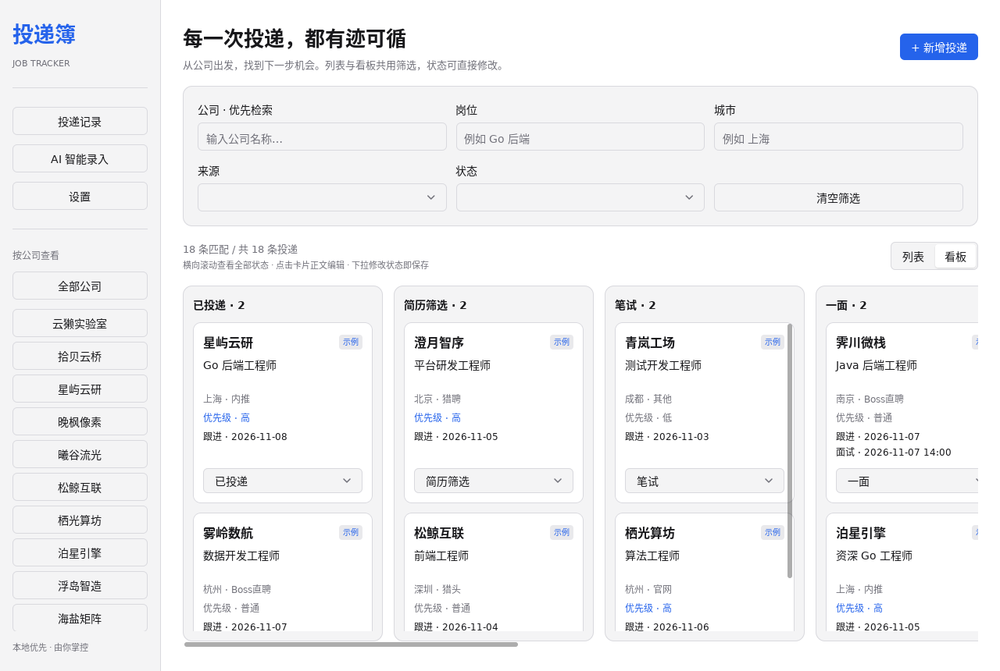
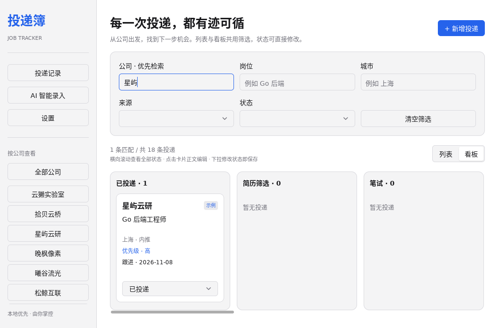
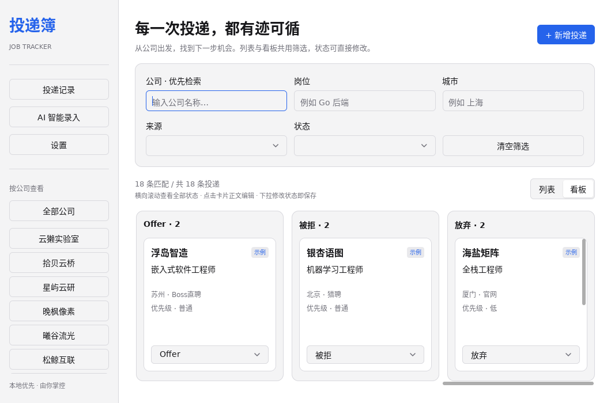
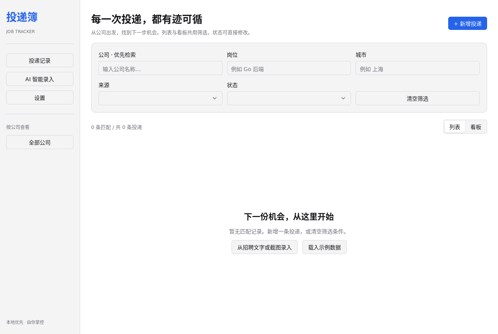
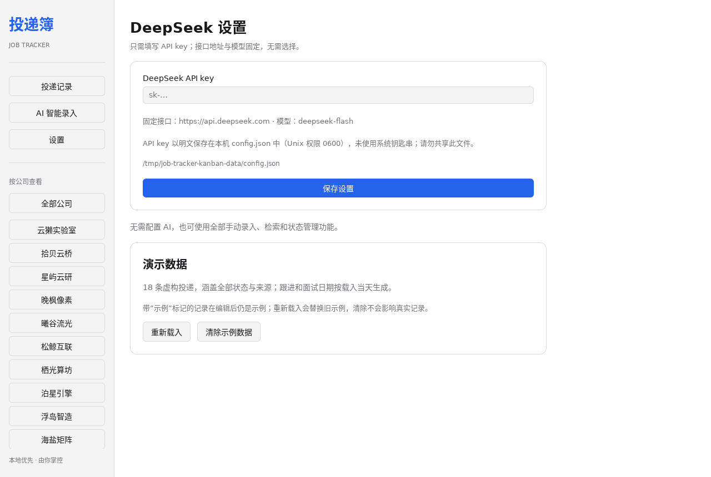

# 投递簿 · Job Tracker

一个本地优先的桌面求职投递追踪器：按公司梳理机会，用列表或看板更新投递状态，把招聘文字或截图转成待确认草稿。

使用 [MyGo](https://github.com/egoist/mygo) **原生 UI（`ui` 包）**，全部界面由 Go 编写。无 HTML、JavaScript、Bun、WebView；SQLite 使用纯 Go 驱动 [`modernc.org/sqlite`](https://pkg.go.dev/modernc.org/sqlite)，无需 cgo 或 C 编译器。


> 截图均为真实 Linux 原生窗口，使用虚构演示数据；AI 截图使用本地模拟接口，不代表真实模型的识别准确率。首次启动数据库为空，不会自动导入示例数据。

## 快速运行

需要 **Go 1.27.3+**，以及桌面图形环境。进入项目根目录后：

```sh
go run .
```

窗口图标通过 `go:embed` 嵌入，启动时调用 `SetIcon`，因此 `go run .` 也有图标，不依赖打包生成的 exe 资源。`resources/icon.png` 为 1024×1024 打包图标；`resources/window-icon.png` 是同图的 256×256 运行时版本，兼容 GTK/X11。Windows / Linux 用于标题栏和任务栏；macOS 窗口不单独显示图标，打包仍使用 1024px 版本。图标设置失败只记日志，不阻止启动。

开发时自动重建：

```sh
go tool mygo dev
```

平台要求：

| 平台 | 运行时依赖 |
| --- | --- |
| macOS 12+ | 无额外依赖 |
| Windows 10 / 11 | 无额外依赖，无需 WebView2 |
| Linux x64 / arm64 | GTK 3、OpenGL；建议安装中文字体，无需 WebKitGTK |

Debian / Ubuntu：

```sh
sudo apt-get install libgtk-3-0 libgl1 fonts-noto-cjk
go run .
```

项目由官方模板初始化：

```sh
go run github.com/egoist/mygo/cmd/mygo@latest init -template native job-tracker
```

## 使用

### 手动投递与检索

1. 点击「新增投递」，填写公司、岗位，确认保存。**内推 / 猎头来源还必须填写对应姓名**。
2. 公司、岗位、城市支持不区分大小写的子串匹配；来源、状态为精确匹配。五个条件取交集（AND），空值表示不限。
3. 左侧公司列表可快速填入公司条件；「全部公司」只清除公司条件，「清空筛选」清除全部条件。
4. 直接使用列表行内的状态下拉框，无需打开编辑页；更新后立即写入 SQLite。
5. 点击「编辑」查看或修改全部字段；长表单可滚动，保存按钮固定在上方。「取消」不保存当前表单；切换其他页面同样不保存。
6. 删除前有二次确认，确认后不可撤销。

列表按投递日期从新到旧排序，同一天按新增顺序倒序。窄窗口可横向滚动表格查看操作列；长公司名和岗位名可在编辑页完整查看。

### 看板视图（Kanban）

「投递记录」默认使用列表，可在筛选栏下切换「列表 / 看板」。切换不清除条件，两种视图共用公司、岗位、城市、来源、状态的筛选交集；重启后仍默认列表。

- 按九个状态固定分列，每列显示匹配数量；空列保留并显示「暂无投递」。
- 卡片展示公司、岗位、城市、来源、优先级，以及已填写的跟进日期 / 面试时间。
- 点击卡片正文打开编辑页，保存后回到原看板；使用卡片底部下拉框改状态，立即写入 SQLite 并移动到对应列。若不再符合状态筛选，卡片会消失，但修改仍已保存。
- 列等宽、卡片等高；横向滚动查看全部状态，列内可独立纵向滚动。窄窗口无需缩小卡片；可使用横向滚轮 / 触控板或拖动底部滚动条。暂不支持拖拽改状态。







### 示例数据

首次启动不会自动添加数据。空列表中的「载入示例数据」，或「设置 → 演示数据」可随时使用，正式版同样提供。

1. 点击「载入示例数据」，确认后添加 **18 条虚构投递**：覆盖全部九种状态、六种来源及多个城市；内推 / 猎头附带虚构姓名。
2. 日期按载入当天生成：包含今天跟进、已过期跟进和近期面试，用来体验筛选、列表及看板；日期不会随每天启动自动滚动，也不触发提醒。
3. 公司旁有「示例」标签。编辑、改状态后仍保留示例标记，不能通过修改公司名变为真实记录。
4. 已有示例时按钮变为「重新载入」；确认后在同一事务中替换旧示例，不会重复累加，**旧示例中的个人修改会丢失**。
5. 「设置 → 演示数据 → 清除示例数据」需确认，**只删除 `is_demo=1` 的记录**，不会按公司名或其他文本猜测；同名的真实投递也保留。无示例时清除按钮不可用。

载入 / 重新载入 / 清除均保留当前筛选。数据库自动从旧版 `user_version=1` 迁移到 `2`，旧记录默认是真实记录；建议升级前备份数据目录，升级后不要再用旧版程序打开数据库。



### 记录字段

- 机会：公司、岗位、城市、来源、内推人 / 猎头姓名、岗位链接、薪资。
- 进度：状态、投递日期、下次跟进日期、面试时间、优先级。
- 详情：JD 原文、联系人、备注。

来源提供内推、Boss直聘、猎聘、猎头、官网、其他建议，也可直接输入自定义值；保存过的来源会出现在筛选选项中。

状态：已投递、简历筛选、笔试、一面、二面、HR面、Offer、被拒、放弃。优先级：普通、高、低。薪资为可选纯文本，不参与筛选。

日期格式为 `YYYY-MM-DD`，面试时间为 `YYYY-MM-DD HH:MM`，按设备本地时区填写；可留空。新记录默认当天、已投递、普通优先级。**记录跟进日期不等于发送提醒**。

### AI 智能录入

1. 在「设置」中只需填写 **DeepSeek API key**，点击「保存设置」。接口和模型固定为 `https://api.deepseek.com`、`deepseek-flash`，不可修改；不填 key 也可使用全部手动功能。
2. 打开「AI 智能录入」，粘贴招聘文字 / JD；也可「粘贴截图」，或通过「选择图片」加载文件。文字与图片可同时提交。
3. 点击「生成待确认草稿」，提取在后台执行；可取消请求，切换页面也会取消，过期结果不会覆盖新页面。
4. 在「确认 AI 草稿」页逐项修正，点击「确认保存」才写入数据库。「取消」不会保存。




接口规则与限制：

- 仅支持 DeepSeek，固定向 `https://api.deepseek.com/chat/completions` 发送请求，模型为 `deepseek-flash`；旧配置里的 `base_url`、`model` 一律忽略。
- 使用 Chat Completions、Bearer token、`response_format: {"type":"json_object"}`，截图通过 base64 data URL 发送；不做本地 OCR。
- PNG / JPEG / WebP，最大 **10 MiB**。剪贴板无图片或平台读取失败时，改用文件选择；当前未实现拖放。
- 请求超时 **45 秒**，响应上限 **2 MiB**。遇到 HTTP 错误、格式错误或缺失配置会显示提示，不会生成已保存记录。
- 仅提取公司、岗位、城市、来源、来源人、岗位链接、JD、联系人、备注、薪资；未知信息留空。模型不能设置记录 ID、状态、日期或优先级；这些采用本地默认值。
- 模型未返回 JD 时，保留粘贴文字。只有截图时没有本地 OCR，依赖视觉模型。
- 模型可能遗漏或误判；**必须人工核对**，草稿缺少必填字段时不能保存。

### 隐私与本地文件

记录保存在本机 SQLite，无云同步。仅点击 AI 生成按钮时，将录入页的文字和图片发送给 DeepSeek；不会附带其他投递记录。没有后台遥测。

默认目录由 Go 的 `os.UserConfigDir()` 决定：

| 平台 | 默认位置 |
| --- | --- |
| Linux | `$XDG_CONFIG_HOME/job-tracker`，未设置时 `~/.config/job-tracker` |
| macOS | `~/Library/Application Support/job-tracker` |
| Windows | `%AppData%\job-tracker` |

目录内：`applications.db` 保存投递；`config.json` 仅保存 `api_key`，再次保存时会移除旧的接口和模型字段。新建目录权限为 `0700`，数据库与配置文件在 Unix 上为 `0600`；Windows 权限由系统 ACL 决定。

**API key 为本地明文，不使用系统钥匙串。** 设置页输入框隐藏 key；不要分享配置文件或把真实数据提交到 GitHub。日志与接口错误不会输出 key 或服务端原始响应；DeepSeek 请求固定使用 HTTPS。

可指定独立目录进行演示、测试或便携使用：

```sh
go run . --data-dir ./my-private-data
```

备份时先退出应用，再复制整个数据目录；恢复时同样先退出。不要同时运行多个实例编辑同一数据库；MVP 没有跨实例实时刷新。

## 构建与验证

```sh
go test ./...
go vet ./...
go tool mygo vet .
go tool mygo build
```

构建输出在 `build/<os>-<arch>/`，包含原生可执行文件和平台安装包。也可跨平台打包（签名、公证以及 macOS DMG 制作需要对应环境）：

```sh
go tool mygo build -platform darwin/universal,windows/amd64,linux/amd64
```

验证记录：

- `CGO_ENABLED=0 go test -count=1 ./...`：通过；覆盖 SQLite 全字段重开持久化、CRUD、日期校验、五维筛选、看板分组、示例覆盖 / 重载 / 安全清除 / 旧库迁移、配置权限，以及 AI 多模态请求、取消与错误处理。
- `go test -race -count=1 ./...`、`go vet ./...`、`go tool mygo vet .`：通过。
- MyGo 无窗口交互测试（`ui.NewTester`）：新增 / 编辑 / 删除确认、列表与看板共用筛选、跨列与筛选中改状态落库、卡片编辑返回看板、示例载入 / 重载 / 清除及取消确认、设置保存、AI 草稿确认前不落库。
- Linux 原生窗口：使用本功能载入的 18 条示例数据验证看板切换、状态菜单、正文编辑、横向 / 列内滚动及 1060×700 窄窗口；检查列表 / 看板示例标签、空状态与设置区块，未调用真实 AI。
- Linux `go run .`：标题栏 / 任务栏图标、仅 key 设置保存（密码掩码）、文件选择附加招聘截图；已检查默认 / 已保存截图及真实鼠标录屏。
- `go tool mygo build -platform linux/amd64`：成功生成可执行文件、`.deb` 和 `.tar.gz`。`go tool mygo build -platform windows/amd64`：成功生成 exe，因未安装 NSIS 跳过安装包。macOS arm64 交叉编译通过；Windows / macOS 均未实机运行。
- 未调用真实 DeepSeek；固定接口、模型与截图请求通过本地 mock 验证，服务端模型可用性与识别准确率未实测。Linux orb 无 GPU，窗口使用 MyGo 的 CPU 绘制回退。

## 代码组织

- `main.go`：数据目录、应用生命周期与原生窗口。
- `app.go`：界面状态、持久化动作、图片附件与可取消的后台提取。
- `views.go`：列表、看板、筛选、编辑、AI 录入、设置与确认对话框；无 webview。
- `internal/tracker/`：领域校验、SQLite 与迁移、示例数据、仅 key 的配置文件、DeepSeek 客户端；不依赖 UI，可独立测试。
- `main_test.go`：从用户操作入口验证完整流程。

## Roadmap（尚未实现）

- [ ] 跟进提醒
- [ ] CSV 导出
- [ ] 统计图
